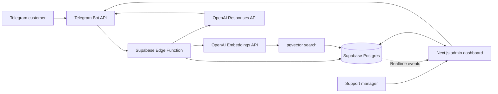

<div align="center">

# SupportFlow AI

### AI-powered Telegram support desk for modern teams

Turn Telegram conversations into an organized support workflow with real-time collaboration, manager routing, and knowledge-grounded AI replies.

[](https://nextjs.org/)
[](https://react.dev/)
[](https://www.typescriptlang.org/)
[](https://supabase.com/)
[](https://platform.openai.com/)
[](https://core.telegram.org/bots/api)

[Live application](https://supportbotadmin.vercel.app) · [Architecture](docs/c4/README.md) · [Data model](docs/erd/README.md) · [Sequence diagrams](docs/sequence/README.md)

</div>

## About the project

SupportFlow AI is a full-stack customer support workspace built around Telegram. Incoming messages are captured by a Supabase Edge Function, stored as structured conversations, and delivered to an authenticated manager dashboard in real time.

The AI assistant answers from a managed knowledge base instead of inventing product details. When the knowledge base does not contain a sufficiently relevant answer, the bot falls back safely and routes the conversation to a human manager.

## Core features

- **Telegram support channel** — receives customer messages through a webhook and sends manager or AI replies through the Telegram Bot API.
- **Real-time inbox** — synchronizes conversations, assignments, manager statuses, and team messages with Supabase Realtime.
- **Conversation workflow** — tracks new, in-progress, and completed conversations with assignee, priority, and unread state.
- **Manager routing** — assigns and reassigns clients while preserving the previous assignee and reassignment author.
- **Team workspace** — includes an internal manager chat, read markers, presence, and custom availability statuses.
- **Knowledge base** — provides category and article CRUD, search, activation controls, and embedding status tracking.
- **RAG auto-replies** — retrieves relevant articles with pgvector, applies a similarity threshold, and uses the OpenAI Responses API to rewrite the selected answer naturally without adding new facts.
- **Human handoff controls** — AI replies can be disabled per conversation and stop automatically once a manager takes over the dialog.
- **AI observability** — records reply decisions, confidence scores, matched article IDs, daily usage, source messages, and final responses.
- **Secure manager access** — uses Supabase Auth, server-managed session cookies, manager checks, and Row Level Security policies.

## How the AI pipeline works

1. The Telegram webhook identifies or creates the client and saves the incoming message.
2. Deterministic intents handle common messages such as greetings, thanks, urgency, and requests for a manager.
3. Other questions are converted into embeddings with `text-embedding-3-small` by default.
4. The `match_kb_entries` Postgres function performs vector similarity search against active knowledge-base articles.
5. Matches below the configured confidence threshold are rejected and trigger a safe handoff response.
6. For a valid match, the OpenAI Responses API reformulates the stored answer in concise, natural Russian without introducing new information.
7. The reply, confidence, matched entries, and decision are persisted for later review.

## Architecture



Detailed PlantUML diagrams are available in [`docs/c4`](docs/c4), [`docs/erd`](docs/erd), and [`docs/sequence`](docs/sequence).

## Tech stack

| Layer | Technology |
| --- | --- |
| Admin application | Next.js 16, React 19, TypeScript, Tailwind CSS 4 |
| Backend | Next.js Route Handlers, Supabase Edge Functions, Deno |
| Data | Supabase Postgres, pgvector, database migrations |
| Real-time | Supabase Realtime, Postgres changes, Presence |
| Authentication | Supabase Auth, HTTP-only session cookies, RLS |
| AI | OpenAI Embeddings API, OpenAI Responses API, RAG |
| Messaging | Telegram Bot API and webhooks |
| Deployment | Vercel and Supabase |

## Repository structure

```text
.
├── support-admin/                 # Next.js manager dashboard and API routes
│   └── src/
│       ├── app/                   # Pages, authentication, and server endpoints
│       ├── components/            # Inbox, conversation, team, and KB interfaces
│       └── lib/                   # Supabase clients, auth, and embedding logic
├── supabase/
│   ├── functions/telegram-webhook # Telegram ingestion and AI reply pipeline
│   ├── migrations/                # Schema, RLS, Realtime, pgvector, and workflow
│   └── seed.sql                   # Local development data
└── docs/                          # C4, ERD, and sequence diagrams
```

## Local development

### Prerequisites

- Node.js 20.9 or newer
- pnpm
- Docker
- Supabase CLI
- A Telegram bot token
- An OpenAI API key

### 1. Clone and start Supabase

```bash
git clone https://github.com/Ilja-Prihach/Full_Stack_Bot.-.git
cd Full_Stack_Bot.-
supabase start
supabase db reset
```

Use `supabase status` to obtain the local API URL, anon key, and service-role key.

### 2. Configure the admin application

Create `support-admin/.env.local`:

```dotenv
NEXT_PUBLIC_SUPABASE_URL=http://127.0.0.1:54321
NEXT_PUBLIC_SUPABASE_ANON_KEY=your_anon_key
SUPABASE_SERVICE_ROLE_KEY=your_service_role_key
TELEGRAM_BOT_TOKEN=your_telegram_bot_token
OPENAI_API_KEY=your_openai_api_key

# Optional overrides
OPENAI_EMBEDDING_MODEL=text-embedding-3-small
```

Install dependencies and run the dashboard:

```bash
cd support-admin
pnpm install
pnpm dev
```

The application will be available at [http://localhost:3000](http://localhost:3000).

### 3. Run the Telegram webhook locally

Create `supabase/.env.local`:

```dotenv
TELEGRAM_BOT_TOKEN=your_telegram_bot_token
SUPABASE_URL=http://127.0.0.1:54321
SUPABASE_SERVICE_ROLE_KEY=your_service_role_key
OPENAI_API_KEY=your_openai_api_key

# Optional overrides
OPENAI_TEXT_MODEL=gpt-4o-mini
OPENAI_EMBEDDING_MODEL=text-embedding-3-small
```

From the repository root, run:

```bash
supabase functions serve telegram-webhook \
  --env-file supabase/.env.local \
  --no-verify-jwt
```

Expose the local function through an HTTPS tunnel and register its URL as the Telegram webhook while developing.

## Useful commands

Run these commands from `support-admin`:

```bash
pnpm dev       # Start the development server
pnpm lint      # Run ESLint
pnpm build     # Create a production build
pnpm start     # Start the production server
```

Run Supabase commands from the repository root:

```bash
supabase start
supabase db reset
supabase functions serve telegram-webhook --env-file supabase/.env.local --no-verify-jwt
```

## Author

Built by [Ilja Prihach](https://github.com/Ilja-Prihach).

